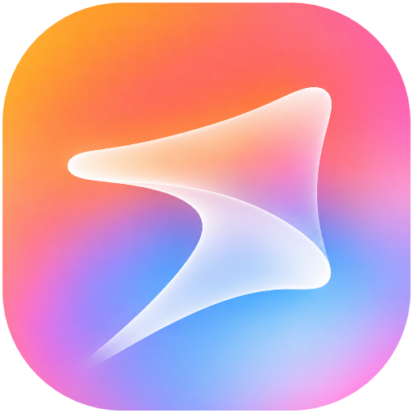
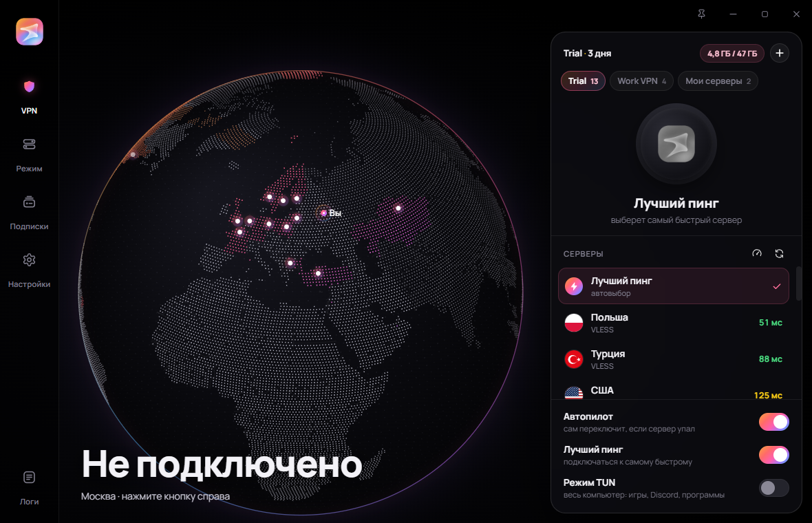
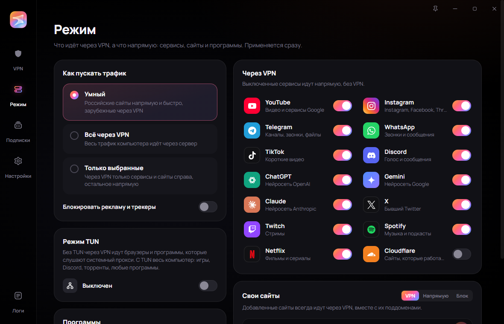
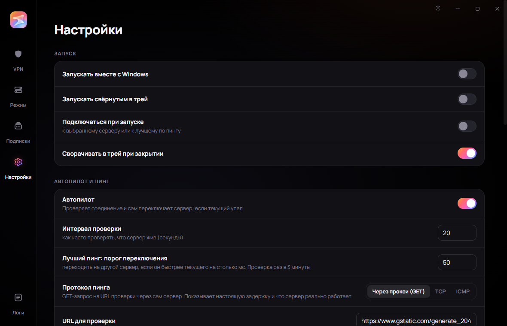

<div align="center">



# Uvelo

**Открытый VPN-клиент для Windows**

Подписки, VLESS, Hysteria2, TUN и автопилот в одном окне.<br>
Сам выбирает самый быстрый сервер и переключается, если текущий упал.

[](https://github.com/pxdxx/uvelo/releases/latest)
[](LICENSE)
[](#скачать)

[](https://github.com/pxdxx/uvelo/releases)
[](https://github.com/pxdxx/uvelo/stargazers)

<a href="https://github.com/pxdxx/uvelo/releases/latest/download/Uvelo-Setup.exe">
  
</a>

[Возможности](#возможности) · [Скачать](#скачать) · [Сборка](#сборка-из-исходников) · [Ограничения](#ограничения)

</div>

<p align="center">
  
</p>

<p align="center">
  
  
</p>

## Возможности

- **Протоколы:** VLESS (Reality, XTLS), VMess, Trojan, Shadowsocks, Hysteria2, TUIC, WireGuard, AnyTLS, SOCKS, HTTP. Транспорты TCP, WS, gRPC, HTTPUpgrade, XHTTP, mKCP.
- **Подписки** по ссылке, списком ссылок, в base64 или как JSON для Xray и sing-box. Несколько подписок, остаток трафика и срок, автообновление.
- **Автопилот:** проверяет соединение и сам переключается, если сервер упал.
- **Лучший пинг:** подключается к самому быстрому серверу и переходит на другой, если тот быстрее на 50 мс.
- **Честный пинг:** запрос через сам сервер, а не только до его порта. Можно выбрать TCP или ICMP.
- **TUN:** через VPN идёт весь компьютер, включая игры, Discord и торренты.
- **Умная маршрутизация:** российские сайты напрямую, остальное через VPN. Можно пустить через VPN только выбранные сервисы.
- **Сервисы, сайты и программы:** YouTube, Telegram, Discord, ChatGPT и другие включаются одним тумблером. Свои сайты и любые .exe можно пустить через VPN, напрямую или заблокировать.
- **Глобус:** серверы подписки на карте, по клику на страну открывается карточка с флагом, столицей, временем и расстоянием.
- Блокировка рекламы, системный прокси, трей, автозапуск.

## Скачать

| Система | Файл |
| --- | --- |
| Windows 10 и 11, 64 бита | [`Uvelo-Setup.exe`](https://github.com/pxdxx/uvelo/releases/latest/download/Uvelo-Setup.exe) |

1. Запустите `Uvelo-Setup.exe` и выберите папку установки.
2. Установщик не подписан, поэтому SmartScreen может показать «Система Windows защитила ваш компьютер». Нажмите **«Подробнее»**, затем **«Выполнить в любом случае»**.
3. Скопируйте ссылку на подписку и нажмите **+** в правой панели.

Uvelo работает с правами администратора, они нужны для TUN.

## Сборка из исходников

Нужен [Node.js](https://nodejs.org/) 22 или новее.

```bash
npm install
npm run fetch-cores   # скачать sing-box, Xray и списки маршрутизации
npm run dev           # запуск
npm run dist          # установщик в dist/
```

## Ограничения

- Uvelo только **клиент**: серверы и подписку нужно взять у своего провайдера.
- Для VLESS, VMess и Trojan используется Xray, для остальных протоколов sing-box. Ядро можно выбрать вручную в настройках.
- Подписки и настройки хранятся только на вашем компьютере.

## Благодарности

- [sing-box](https://github.com/SagerNet/sing-box) и [Xray-core](https://github.com/XTLS/Xray-core): ядра.
- [runetfreedom](https://github.com/runetfreedom/russia-v2ray-rules-dat): списки блокировок РФ.
- [Simple Icons](https://simpleicons.org): иконки сервисов.

## Связь

- Telegram: [@pxdxz](https://t.me/pxdxz)
- Нашли ошибку? Откройте [issue](https://github.com/pxdxx/uvelo/issues).

## Лицензия

[GPL-3.0](LICENSE) © 2026 pxdxx
